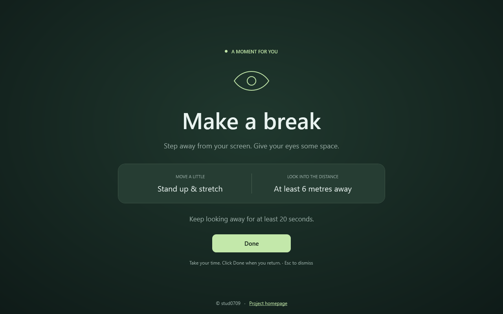
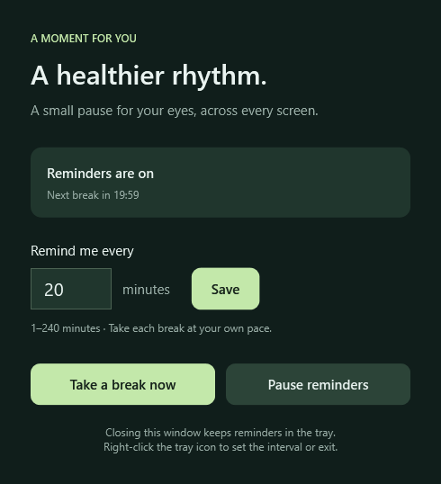

# A moment for you

A gentle Windows tray app that reminds you to step away from screen work, move around, and rest your eyes.

[Download the latest release](https://github.com/stud0709/moment-for-you/releases/latest) · [Build status](https://github.com/stud0709/moment-for-you/actions/workflows/build-release.yml)



Every **20 minutes** by default, an opaque break window covers each connected monitor. It asks you to stand up and move around, then look at something at least **6 metres away for at least 20 seconds**.

There is **no countdown**. The **Done** button is available immediately, so you can take your time and dismiss the screen when you return. Clicking Done on any monitor closes all break windows and starts a fresh reminder interval. **Esc** or **Alt+F4** also dismisses the break.

## Get started

1. Open [Releases](https://github.com/stud0709/moment-for-you/releases/latest), download the **win-x64.zip**, and extract it.
2. Run **A moment for you.exe** from the extracted folder. The portable Windows x64 app needs no installer, administrator access, or separate .NET installation.
3. Click **Take a break now** to try it, or set an interval between **1 and 240 minutes** and click **Save**.

The app is unsigned, so Windows may show its usual reputation warning. Exit any older copy from its tray menu before opening a new version.

You can also download the standalone **A.moment.for.you.exe**. GitHub uses dots instead of spaces in release asset names; the ZIP preserves **A moment for you.exe**. Both contain the same app.

## Settings and tray controls



Closing the settings window keeps the app running in the notification area. The eye icon may be under the Windows tray overflow arrow. Double-click it to reopen settings, or right-click it for:

| Command | What it does |
| --- | --- |
| **Set interval…** | Choose 1–240 minutes and save. A full new interval starts immediately. |
| **Take a break now** | Show the break screen on every connected monitor. |
| **Pause reminders / Resume reminders** | Pause automatic reminders; resuming starts a full new interval. |
| **Exit** | Dismiss every break window and quit. |

Reminders restart their interval after sleep or unlocking Windows. Connecting or disconnecting a monitor during a break rebuilds the windows while keeping the break open. The app supports per-monitor scaling and monitors positioned to the left of the primary screen.

This is a break reminder, not a Windows security lock. Windows shortcuts, the secure desktop, and some privileged or exclusive fullscreen windows can still take precedence.

Your interval is stored locally in `%LOCALAPPDATA%\EyeProtect\settings.json`. The original settings folder is retained so earlier versions keep their saved interval. The app does not send telemetry or make network requests.

The app does not register itself for startup. To launch quietly, create a shortcut to **A moment for you.exe** with `--tray` as an argument; you can place that shortcut in your Windows Startup folder.

## Build and test

Requires Windows, the **.NET 10 SDK**, and PowerShell 7. No external NuGet packages are used.

```powershell
./scripts/Build.ps1
```

This publishes the self-contained x64 app, runs its automated checks, and writes the executable, ZIP, and `SHA256SUMS.txt` to `artifacts/release/`.

For a quick development build:

```powershell
dotnet build -c Release
dotnet run -c Release --no-build -- --self-test
dotnet run -c Release --no-build -- --render-preview artifacts/break-preview.png
```

`--self-test` checks scheduling, immediate dismissal and long breaks, pause/resume, clock gaps, settings persistence and invalid settings, the actual WPF Done button, native window bounds on every connected monitor, and tray menu actions. It writes `artifacts/self-test-results.txt` and returns a nonzero exit code on failure. It briefly creates a tray icon but never displays a break.

`--render-preview` renders the actual WPF break content and settings window to PNG without covering your desktop. The screenshots above come from this renderer.

For manual verification, use **Take a break now** with multiple monitors and mixed scaling. Check that each screen, including its taskbar, is covered and Done is available immediately. Confirm that clicking Done on a secondary monitor closes every break window, Esc works, and monitor changes during a break are handled. Set a 1-minute interval to test automatic reminders and confirm pause suppresses them.

## Release pipeline

[GitHub Actions](.github/workflows/build-release.yml) builds and tests Windows x64 on pushes to `main`, pull requests, and manual runs. Successful builds provide downloadable workflow artifacts.

To publish a release:

1. Update the version in `MomentForYou.csproj` and `app.manifest`.
2. Add release notes at `docs/releases/vX.Y.Z.md`, commit, and push to `main`.
3. Push an annotated tag matching the project version:

```powershell
git tag -a v1.0.1 -m "Release v1.0.1"
git push origin v1.0.1
```

The tag workflow validates the version, builds the app, runs its checks, packages it, and verifies checksums. Only after those steps succeed does it publish a GitHub release with the executable, ZIP, and checksum file. No personal access token or extra repository secret is required; the release job uses the repository's `GITHUB_TOKEN`.

© stud0709 · [Project homepage](https://github.com/stud0709/moment-for-you)
